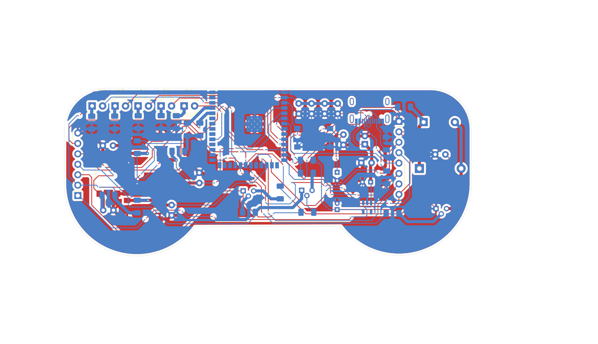
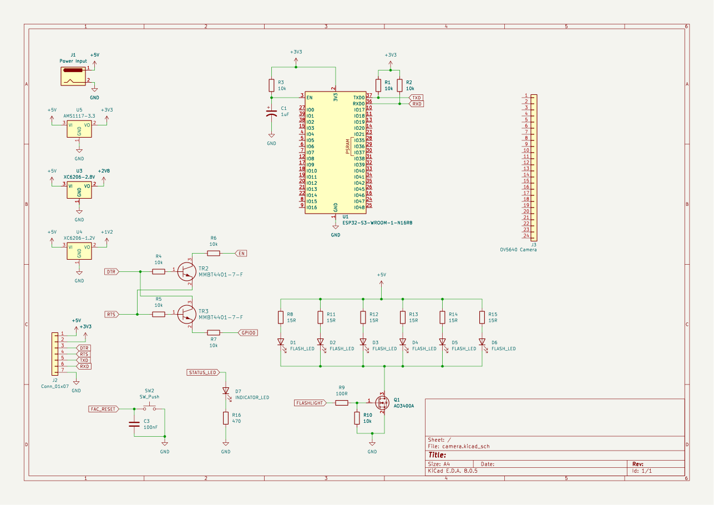
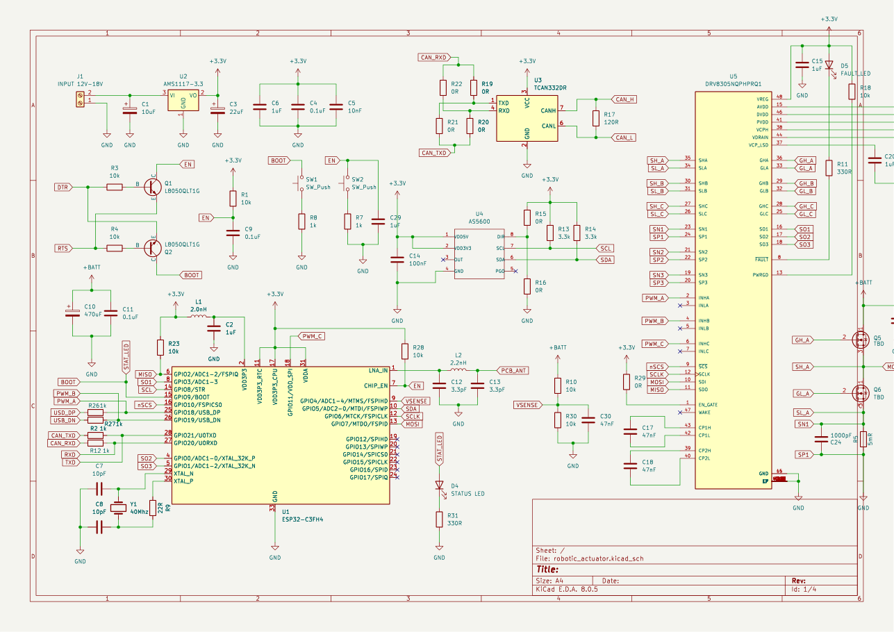

# PCB Designs

Circuit boards I designed for my robotics and embedded projects, in KiCad (plus OmniDrone in Altium). All of them were fabricated, assembled, and brought up working.

| Board | Tool | Key parts |
|---|---|---|
| [ESP32-S3 desk robot](#esp32-s3-desk-robot) | KiCad | ESP32-S3-WROOM-1, 1.69" ST7789 SPI LCD, USB-C, buzzer, push buttons, LDO |
| [ESP32-S3 camera board](#esp32-s3-camera-board) | KiCad | ESP32-S3-WROOM-1, 24-pin camera FPC (IMX219-class sensor), 2.8 V / 1.2 V / 3.3 V rails, LED flash driver, DC jack |
| [Brushless actuator controller](#brushless-actuator-controller) | KiCad | ESP32-C3, DRV8305 three-phase gate driver, six IRF40DM229 MOSFETs, TCAN332 CAN transceiver, AS5600 magnetic encoder, LM75B temperature sensor, LMR14206 buck |
| [OmniDrone](#omnidrone) | Altium | ESP-12 (ESP8266), MPU6050 IMU, HMC5883L magnetometer, MS5611 barometer, TP4056 charger |

Each KiCad folder has the design files (`.kicad_pro`, `.kicad_sch`, `.kicad_pcb`), a `schematic.pdf`, and PNG previews in `images/`. Manufacturer datasheets, 3D models, and vendor footprint libraries are not redistributed here; the symbols and footprints are embedded in the KiCad files.

## ESP32-S3 desk robot
A gift desk robot: an ESP32-S3 drives a color LCD face and a buzzer and reads six buttons, powered over USB-C.

## ESP32-S3 camera board
A camera board for robot vision. It carries the extra 2.8 V and 1.2 V rails the image sensor needs, plus a transistor-switched LED flash.

## Brushless actuator controller
A controller for a humanoid-robot joint: an ESP32-C3 drives a brushless motor through a DRV8305 gate driver and a six-MOSFET three-phase bridge, reads rotor angle from an AS5600 magnetic encoder, monitors temperature, and talks to the rest of the robot over CAN. The design is split into a control board and a power bridge board (separate schematic sheets), with the original single-sheet version kept as `source.kicad_sch`.

## OmniDrone
A mini drone whose frame is the circuit board itself, designed in Altium: ESP-12 Wi-Fi flight computer, IMU, magnetometer and barometer, and onboard LiPo charging. See `omnidrone/` for the schematic and board exports.

---
Vinicio Castillo · [GitHub](https://github.com/Acrazt05) · [LinkedIn](https://www.linkedin.com/in/vinicio-castillo) · [Portfolio](https://github.com/Acrazt05/portfolio)
